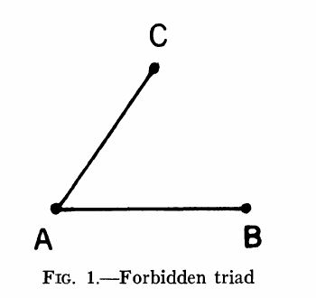
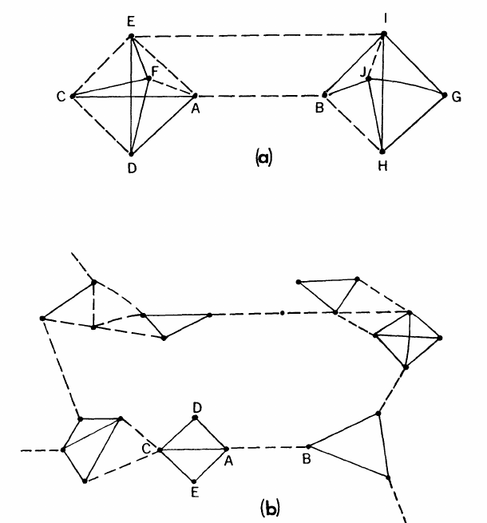

# Die Stärke schwacher Bindungen

Mark S. Granovetter · Johns Hopkins University

Original: *The Strength of Weak Ties*, American Journal of Sociology 78(6), Mai 1973, S. 1360–1380.

> Deutsche Arbeitsübersetzung der vom Nutzer bereitgestellten PDF `granovetter73weakties.pdf`. Die Seitenangaben beziehen sich auf die gedruckten Originalseiten. Das JSTOR-Deckblatt ist nicht Teil des Aufsatzes. Bibliografische Titel bleiben im Original. „Tie“ wird durchgehend als „Bindung“ übersetzt. Die Abbildungen werden aus der Vorlage übernommen. Historische Bezeichnungen für Bevölkerungsgruppen werden sinngemäß mit heutigen deutschen Bezeichnungen wiedergegeben.

## Zusammenfassung

Die Analyse sozialer Netzwerke wird als Werkzeug vorgeschlagen, um die Mikro- und Makroebene soziologischer Theorie miteinander zu verbinden. Das Vorgehen wird veranschaulicht, indem die makrosozialen Folgen eines Aspekts kleinräumiger Interaktion ausgearbeitet werden: der Stärke dyadischer Bindungen. Es wird argumentiert, dass sich die Überschneidung der Freundschaftsnetzwerke zweier Personen mit der Stärke ihrer Bindung zueinander erhöht. Untersucht werden die Auswirkungen dieses Prinzips auf die Verbreitung von Einfluss und Informationen, auf Mobilitätschancen und auf die Organisation von Gemeinschaften. Besonderes Gewicht liegt auf der zusammenhaltenden Wirkung schwacher Bindungen. Die meisten Netzwerkmodelle beschäftigen sich implizit mit starken Bindungen und beschränken damit ihre Anwendbarkeit auf kleine, klar abgegrenzte Gruppen. Die Betonung schwacher Bindungen ermöglicht dagegen die Diskussion von Beziehungen *zwischen* Gruppen und die Analyse von Teilen der Sozialstruktur, die sich nicht leicht anhand von Primärgruppen abgrenzen lassen.

## Einleitung

<!-- Originalseite 1360 -->

Eine grundlegende Schwäche der gegenwärtigen soziologischen Theorie besteht darin, dass sie Interaktionen auf der Mikroebene nicht überzeugend mit Mustern auf der Makroebene verbindet. Groß angelegte statistische wie auch qualitative Untersuchungen bieten zahlreiche Einsichten in Makrophänomene wie soziale Mobilität, die Organisation von Gemeinschaften und politische Strukturen. Auf der Mikroebene liefert ein umfangreicher und wachsender Bestand an Daten und Theorien nützliche und aufschlussreiche Vorstellungen darüber, was sich innerhalb kleiner Gruppen abspielt. Wie sich Interaktionen in kleinen Gruppen jedoch zu großräumigen Mustern zusammenfügen, entzieht sich uns in den meisten Fällen.

Ich werde in diesem Aufsatz argumentieren, dass die Analyse von Prozessen in zwischenmenschlichen Netzwerken die fruchtbarste Brücke zwischen Mikro- und Makroebene bietet. Auf die eine oder andere Weise werden durch diese Netzwerke kleinräumige Interaktionen in großräumige Muster übersetzt; diese wirken wiederum auf kleine Gruppen zurück.[^1]

Die Soziometrie, die Vorläuferin der Netzwerkanalyse, hat in der soziologischen Theorie stets eine merkwürdig randständige, eigentlich unsichtbare Stellung eingenommen. Das liegt zum Teil daran, dass sie gewöhnlich nur als Teilgebiet der Sozialpsychologie untersucht und angewandt wurde; zum Teil liegt es auch an den Schwierigkeiten einer präzisen Netzwerkanalyse. Weder die Theorie noch die Mess- und Stichprobenverfahren standen uns zur Verfügung, um die Soziometrie von der üblichen Ebene kleiner Gruppen auf die größerer Strukturen zu übertragen.

<!-- Originalseite 1361 -->

Obwohl sich in jüngster Zeit eine Reihe anregender und vielversprechender Untersuchungen in diese Richtung bewegt hat (Bott 1957; Mayer 1961; Milgram 1967; Boissevain 1968; Mitchell 1969), behandeln sie strukturelle Fragen theoretisch nicht besonders ausführlich. Untersuchungen, die dies tun, weisen gewöhnlich eine technische Komplexität auf, wie sie zu schwer zugänglichen Quellen wie dem *Bulletin of Mathematical Biophysics* passt. Dort bestand der ursprüngliche Anlass für die Untersuchung von Netzwerken darin, eine Theorie neuronaler statt sozialer Interaktion zu entwickeln (siehe den nützlichen Überblick über diese Literatur bei Coleman [1960]; außerdem Rapoport [1963]).

Die Strategie dieses Aufsatzes besteht darin, einen recht begrenzten Aspekt kleinräumiger Interaktion auszuwählen — die Stärke zwischenmenschlicher Bindungen — und etwas ausführlicher zu zeigen, wie sich dieser Aspekt mithilfe der Netzwerkanalyse mit so unterschiedlichen Makrophänomenen wie Diffusion, sozialer Mobilität, politischer Organisation und sozialem Zusammenhalt im Allgemeinen verbinden lässt. Obwohl die Analyse im Wesentlichen qualitativ ist, wird ein mathematisch orientierter Leser Möglichkeiten zur Modellbildung erkennen; mathematische Argumente, Hinweise und Literaturverweise finden sich überwiegend in den Fußnoten.

## Die Stärke von Bindungen

Die meisten intuitiven Vorstellungen von der „Stärke“ einer zwischenmenschlichen Bindung dürften durch folgende Definition erfasst werden: Die Stärke einer Bindung ist eine vermutlich lineare Kombination aus dem Zeitaufwand, der emotionalen Intensität, der Intimität — dem gegenseitigen Anvertrauen — und den wechselseitigen Hilfeleistungen, die diese Bindung kennzeichnen.[^2] Jeder dieser Bestandteile ist von den anderen in gewissem Maße unabhängig, obwohl sie offensichtlich stark miteinander korrelieren. Die Diskussion operationaler Maße und der Gewichte der vier Bestandteile bleibt künftigen empirischen Untersuchungen vorbehalten.[^3] Für den vorliegenden Zweck genügt es, wenn die meisten von uns auf einer groben intuitiven Grundlage darin übereinstimmen können, ob eine bestimmte Bindung stark, schwach oder nicht vorhanden ist.[^4]

<!-- Originalseite 1362 -->

Betrachten wir nun zwei beliebig ausgewählte Personen — nennen wir sie A und B — und die Menge S = {C, D, E, …} aller Personen, die mit einer oder beiden verbunden sind.[^5] Die Hypothese, mit der wir dyadische Bindungen mit größeren Strukturen verknüpfen können, lautet: Je stärker die Bindung zwischen A und B, desto größer ist der Anteil der Personen in S, mit denen *beide* verbunden sind, also durch eine schwache oder starke Bindung. Die Überschneidung ihrer Freundeskreise sollte am geringsten sein, wenn ihre Bindung fehlt, am größten, wenn sie stark ist, und dazwischen liegen, wenn sie schwach ist.

Der vorgeschlagene Zusammenhang ergibt sich zunächst aus der definitionsgemäßen Tendenz stärkerer Bindungen, mehr Zeit in Anspruch zu nehmen. Bestehen Bindungen A–B und A–C, dann hängt die Zeit, die C mit B verbringt, zum Teil davon ab, wie viel Zeit A jeweils mit B und C verbringt. Wären die Ereignisse „A ist mit B zusammen“ und „A ist mit C zusammen“ unabhängig, hätte das Ereignis „C ist mit A und B zusammen“ eine Wahrscheinlichkeit, die dem Produkt ihrer Wahrscheinlichkeiten entspricht. Sind A und B beispielsweise 60 % der Zeit zusammen und A und C 40 %, wären C, A und B 24 % der Zeit zusammen. Nachdem B und C einander kennengelernt haben, wäre eine solche Unabhängigkeit weniger wahrscheinlich als zuvor. Haben C und B keine Beziehung, werden ihre gemeinsamen starken Bindungen zu A sie wahrscheinlich miteinander in Kontakt bringen und eine Beziehung entstehen lassen. Darin steckt Homans’ Vorstellung, dass „je häufiger Menschen miteinander interagieren, desto stärker dürften ihre freundschaftlichen Gefühle füreinander sein“ (1950, S. 133).

Die Hypothese wird auch durch empirische Befunde plausibel, denen zufolge zwei Personen einander in verschiedener Hinsicht umso ähnlicher sind, je stärker ihre Bindung ist (Berscheid und Walster 1969, S. 69–91; Bramel 1969, S. 9–16; Brown 1965, S. 71–90; Laumann 1968; Newcomb 1961, Kap. 5; Precker 1952). Verbinden starke Bindungen A mit B und A mit C, dürften B und C, die beide A ähnlich sind, auch einander ähnlich sein. Das erhöht die Wahrscheinlichkeit einer Freundschaft, nachdem sie sich begegnet sind. Umgekehrt zeigen die beiden Faktoren Zeit und Ähnlichkeit, weshalb schwächere Bindungen A–B und A–C eine Bindung C–B weniger wahrscheinlich machen als starke: C und B kommen seltener miteinander in Kontakt und passen, wenn sie es tun, mit geringerer Wahrscheinlichkeit zusammen.

Auch die Theorie des kognitiven Gleichgewichts, wie sie Heider (1958) und besonders Newcomb (1961, S. 4–23) formulieren, sagt dieses Ergebnis voraus. Bestehen starke Bindungen A–B und A–C und wissen B und C voneinander, würde alles andere als eine positive Bindung eine „psychologische Spannung“ erzeugen. C wird seine eigenen Gefühle mit denen seines guten Freundes A in Einklang bringen wollen; dasselbe gilt für B und seinen Freund A. Bei schwachen Bindungen ist eine solche Übereinstimmung dagegen psychologisch weniger entscheidend. Siehe hierzu auch Homans (1950, S. 255) und Davis (1963, S. 448).

Einige direkte Belege für die grundlegende Hypothese liegen vor (Kapferer 1969, S. 229, Anm.; Laumann und Schuman 1967; Rapoport und Horvath 1961; Rapoport 1963).[^6]

<!-- Originalseite 1363 -->

Diese Belege sind weniger umfassend, als man wünschen könnte. Darüber hinaus wurden jedoch bestimmte Folgerungen aus der Hypothese empirisch gestützt. Ihre Darstellung wird einige der inhaltlichen Konsequenzen der bisherigen Argumentation verdeutlichen.

## Schwache Bindungen in Diffusionsprozessen

Um Konsequenzen für große Beziehungsnetzwerke abzuleiten, muss die grundlegende Hypothese präziser formuliert werden. Dazu lassen sich die möglichen Triaden untersuchen, die aus starken, schwachen oder fehlenden Bindungen zwischen A, B und einem beliebig ausgewählten Freund einer oder beider Personen bestehen, also einem Mitglied der oben beschriebenen Menge S. Ein umfassendes mathematisches Modell würde dies ausführlich tun und Wahrscheinlichkeiten für verschiedene Typen angeben. Eine solche Analyse wird allerdings recht kompliziert. Für meinen Zweck genügt die Feststellung, dass nach der obigen Hypothese diejenige Triade am *unwahrscheinlichsten* ist, in der A und B stark verbunden sind und A eine starke Bindung zu einem Freund C hat, die Bindung zwischen C und B aber fehlt. Diese Triade zeigt Abbildung 1.

Um die Folgen dieser Behauptung zu erkennen, werde ich sie im Folgenden zuspitzen und annehmen, dass die dargestellte Triade *niemals* vorkommt: Wenn die beiden anderen starken Bindungen bestehen, ist die Bindung B–C also immer vorhanden, ob schwach oder stark. Die aus dieser Annahme abgeleiteten Ergebnisse sollten in dem Maße auftreten, in dem die betreffende Triade tatsächlich selten ist.

<!-- Originalseite 1364 -->

Es gibt gewisse Belege für dieses Fehlen. Davis (1970, S. 845) analysierte 651 Soziogramme und stellte fest, dass in 90 % von ihnen Triaden aus zwei gegenseitigen Wahlen und einer Nichtwahl seltener vorkamen, als zufällig zu erwarten gewesen wäre. Wenn wir annehmen, dass eine gegenseitige Wahl eine starke Bindung anzeigt, ist dies ein starker Beleg zugunsten meiner Argumentation.[^7] Newcomb (1961, S. 160–165) berichtet, dass bei Triaden aus Dyaden mit gegenseitiger „hoher Anziehung“ die Konfiguration mit drei starken Bindungen häufiger wurde, je länger und besser sich die Beteiligten kannten. Die Häufigkeit der in Abbildung 1 dargestellten Triade wird nicht untersucht; impliziert wird jedoch, dass Prozesse des kognitiven Gleichgewichts dazu neigten, sie zu beseitigen.

Die Bedeutung des Fehlens dieser Triade lässt sich mit dem Begriff der „Brücke“ zeigen: einer Kante in einem Netzwerk, die den *einzigen* Weg zwischen zwei Punkten bereitstellt (Harary, Norman und Cartwright 1965, S. 198). Da im Allgemeinen jeder Mensch sehr viele Kontakte hat, ist eine Brücke zwischen A und B die einzige Route, über die Informationen oder Einfluss von irgendeinem Kontakt von A zu irgendeinem Kontakt von B gelangen können — und damit von jeder indirekt mit A verbundenen Person zu jeder indirekt mit B verbundenen. Bei der Untersuchung von Diffusion ist daher eine wichtige Rolle von Brücken zu erwarten.

Fehlt nun die genannte Triade, folgt daraus, dass außer unter unwahrscheinlichen Bedingungen *keine starke Bindung eine Brücke ist*. Betrachten wir die starke Bindung A–B: Hat A eine weitere starke Bindung zu C, impliziert der Ausschluss der Triade aus Abbildung 1, dass zwischen C und B eine Bindung besteht. Damit existiert der Weg A–C–B zwischen A und B; A–B ist also keine Brücke. Eine starke Bindung kann folglich *nur dann* eine Brücke sein, wenn keiner ihrer beiden Beteiligten irgendeine weitere starke Bindung hat. Das ist in einem sozialen Netzwerk beträchtlicher Größe unwahrscheinlich, wenn auch in einer kleinen Gruppe möglich. Für schwache Bindungen gilt diese Einschränkung nicht, obwohl sie keineswegs automatisch Brücken sind. Entscheidend ist vielmehr, dass alle Brücken schwache Bindungen sind.

In großen Netzwerken dürfte es praktisch selten vorkommen, dass eine bestimmte Bindung den einzigen Weg zwischen zwei Punkten bietet. Die Brückenfunktion kann dennoch lokal erfüllt werden. In Abbildung 2a ist die Bindung A–B beispielsweise keine Brücke im strengen Sinne, da sich der Weg A–E–I–B und weitere Wege konstruieren lassen. Dennoch ist A–B für F, D und C die kürzeste Route zu B. In Abbildung 2b wird diese Funktion deutlicher. Hier ist A–B für C, D und andere nicht nur eine lokale Brücke zu B, sondern in den meisten tatsächlichen Diffusionsfällen auch ein wesentlich wahrscheinlicherer und effizienterer Weg. Harary et al. weisen darauf hin, dass es „eine Entfernung [Weglänge] geben kann, jenseits derer u wegen der Kosten oder Verzerrungen jeder Weitergabe nicht mehr sinnvoll mit v kommunizieren kann. Liegt v außerhalb dieser kritischen Entfernung, erhält er keine von u ausgehenden Nachrichten“ (1965, S. 159).

<!-- Originalseite 1365 -->

Ich bezeichne eine Bindung als „lokale Brücke vom Grad n“, wenn n die Länge des kürzesten anderen Weges zwischen ihren beiden Endpunkten ist und n > 2 gilt. In Abbildung 2a ist A–B eine lokale Brücke vom Grad 3, in 2b vom Grad 13. Wie bei Brücken in einem Straßennetz ist eine lokale Brücke in einem sozialen Netzwerk als Verbindung zwischen zwei Bereichen umso bedeutender, je mehr Menschen auf sie als einzige Alternative angewiesen sind — also je größer ihr Grad ist. Eine Brücke im absoluten Sinne ist eine lokale Brücke unendlichen Grades. Nach derselben Logik wie oben können nur schwache Bindungen lokale Brücken sein.

Nehmen wir nun Davis’ Vorschlag an, dass „bei zwischenmenschlichen Flüssen fast jeder Art die Wahrscheinlichkeit, dass ‚was immer es ist‘ von Person i zu Person j gelangt, (a) direkt proportional zur Zahl ausschließlich positiver Freundschaftswege zwischen i und j und (b) umgekehrt proportional zur Länge dieser Wege ist“ (1969, S. 549).[^8] Die Bedeutung schwacher Bindungen bestünde dann darin, dass diejenigen, die lokale Brücken sind, mehr und kürzere Wege schaffen. Jede beliebige Bindung kann hypothetisch aus einem Netzwerk entfernt werden. Anschließend lassen sich die Zahl der unterbrochenen Wege sowie die Veränderungen der durchschnittlichen Weglänge zwischen beliebigen Punktpaaren berechnen, wobei die betrachtete Weglänge begrenzt werden kann.

<!-- Originalseite 1366 -->

Die Behauptung lautet hier, dass die Entfernung einer durchschnittlichen schwachen Bindung die Übertragungswahrscheinlichkeiten stärker „beschädigen“ würde als die Entfernung einer durchschnittlichen starken Bindung.[^9]

Anschaulich bedeutet dies: Was auch immer verbreitet werden soll, kann mehr Menschen erreichen und größere soziale Entfernungen, also Weglängen,[^10] überwinden, wenn es über schwache statt über starke Bindungen weitergegeben wird. Erzählt jemand allen engen Freunden ein Gerücht und tun diese dasselbe, werden viele das Gerücht ein zweites und drittes Mal hören, weil Menschen mit starken Bindungen häufig gemeinsame Freunde haben. Nimmt die Motivation zur Weitergabe mit jeder Welle etwas ab, bleibt ein über starke Bindungen wanderndes Gerücht viel eher auf wenige Cliquen beschränkt als eines, das über schwache Bindungen weitergegeben wird: Brücken werden dann nicht überschritten.[^11]

Da Soziologen und Anthropologen viele Hundert Diffusionsstudien durchgeführt haben — Rogers’ Überblick von 1962 behandelte 506 — könnte man annehmen, die obigen Behauptungen ließen sich leicht prüfen. Aus mehreren Gründen ist dies jedoch nicht der Fall. Obwohl die meisten Diffusionsstudien persönliche Kontakte als entscheidend erkennen, verzichten viele auf eine soziometrische Untersuchung. Rogers (1962) diskutiert diesen Punkt. Werden soziometrische Verfahren verwendet, entmutigen sie oft die Nennung schwach verbundener Personen, indem sie die erlaubte Zahl der Wahlen stark begrenzen. Die vorgeschlagene Bedeutung schwacher Bindungen für die Diffusion wird daher nicht gemessen. Selbst wenn umfangreichere soziometrische Informationen erhoben werden, wird fast nie versucht, die genauen zwischenmenschlichen Wege nachzuzeichnen, die eine Idee, ein Gerücht oder eine Innovation durchlaufen hat. Häufiger werden der Zeitpunkt der Übernahme einer Innovation und die Zahl der soziometrischen Wahlen erfasst, die jede Person von anderen Studienteilnehmern erhält. Häufig gewählte Personen gelten als „zentral“, selten gewählte als „randständig“. Diese Variable wird dann mit dem Übernahmezeitpunkt korreliert; daraus werden Schlüsse über die vermutlich durchlaufenen Wege gezogen.

<!-- Originalseite 1367 -->

Ein Streitpunkt der Diffusionsforschung lässt sich mit meiner Argumentation verbinden. Einige Untersuchungen beschreiben frühe Innovatoren als randständig: Sie „entsprechen den Normen so wenig, dass sie als stark abweichend wahrgenommen werden“ (Rogers 1962, S. 197). Andere, etwa Coleman, Katz und Menzel (1966) zur Übernahme eines neuen Medikaments durch Ärzte, stellen fest, dass häufiger genannte Personen eine Innovation erheblich früher übernehmen. Becker (1970) versucht die Frage, ob frühe Innovatoren „zentral“ oder „randständig“ sind, durch Bezug auf das „wahrgenommene Risiko der Übernahme einer bestimmten Innovation“ zu klären. Seine Untersuchung von Innovationen im öffentlichen Gesundheitswesen zeigt: Gilt ein neues Programm als relativ sicher und unumstritten, wie das Medikament bei Coleman et al., gehen zentrale Personen bei der Übernahme voran; andernfalls tun dies randständige Personen (S. 273). Er erklärt den Unterschied mit dem stärkeren Wunsch „zentraler“ Personen, ihren beruflichen Ruf zu schützen.

Kerckhoff, Back und Miller (1965) kommen in einer andersartigen Untersuchung zu einem ähnlichen Schluss. In einer Textilfabrik im Süden der USA breitete sich eine „hysterische Ansteckung“ aus: Erst wenige, dann immer mehr Beschäftigte berichteten von Bissen eines geheimnisvollen „Insekts“, litten unter Übelkeit, Taubheitsgefühlen und Schwäche und bewirkten schließlich die Schließung der Fabrik. Als die Betroffenen ihre drei besten Freunde nennen sollten, nannten viele einander. Die allerersten Betroffenen waren jedoch sozial isoliert und erhielten fast keine Nennungen. Als Erklärung wird, im Einklang mit Becker, angeboten: Weil die Symptome ungewöhnlich erscheinen konnten, waren frühe „Übernehmer“ eher unter randständigen Personen zu finden, die weniger sozialem Druck unterlagen. Später „wird es zunehmend wahrscheinlich, dass sozial integrierte Personen betroffen sind … Die Ansteckung gelangt in soziale Netzwerke und verbreitet sich mit wachsender Geschwindigkeit“ (S. 13). Dies passt zu Rogers’ Bemerkung, dass die ersten Übernehmer von Innovationen randständig sind, die nachfolgende Gruppe der „frühen Übernehmer“ aber „stärker in das lokale soziale System integriert ist als die Innovatoren“ (1962, S. 183).

„Zentrale“ und „randständige“ Personen mögen tatsächlich so motiviert sein, wie behauptet. Sind die Randständigen jedoch wirklich isoliert, ist schwer zu erkennen, wie sie Innovationen jemals erfolgreich verbreiten könnten. Wir können vermuten, dass der Widerstand gegen riskante oder abweichende Aktivitäten größer ist als gegen sichere oder normale. Deshalb müssen in der frühen Phase mehr Menschen damit in Berührung kommen und sie übernehmen, bevor eine Kettenreaktion entsteht. Personen mit vielen schwachen Bindungen sind nach meiner Argumentation am besten geeignet, eine solche schwer vermittelbare Innovation zu verbreiten, weil einige dieser Bindungen lokale Brücken sein werden.[^12] Eine zunächst unbeliebte Innovation, die Personen mit wenigen schwachen Bindungen verbreiten, bleibt eher auf wenige Cliquen beschränkt, kommt gar nicht erst zur Entfaltung und gelangt nie in eine Diffusionsstudie.

<!-- Originalseite 1368 -->

Dass die „randständigen“ Innovatoren der Diffusionsstudien tatsächlich viele schwache Bindungen besitzen könnten, ist angesichts der üblichen soziometrischen Verfahren möglich; meist bleibt es jedoch reine Spekulation. Kerckhoff und Back weisen in einer späteren, ausführlicheren Analyse des Hysteriefalls darauf hin, dass sie nicht nur nach den drei besten Freunden fragten, sondern auch danach, mit wem die Beschäftigten aßen, arbeiteten, Fahrgemeinschaften bildeten und so weiter. Sie berichten, dass fünf der sechs zuerst betroffenen Beschäftigten „sozial isoliert sind, wenn Freundschaftswahlen die Analysegrundlage bilden. Nur eine der sechs wird von irgendjemandem in unserer Stichprobe als Freundin genannt. Noch auffälliger wird dies dadurch, dass diese sechs Frauen bei anderen Wahlkriterien recht häufig genannt werden. Tatsächlich werden sie bei Nichtfreundschaftswahlen häufiger gewählt als die Frauen aller anderen Kategorien“ (1968, S. 112).

Dieser Befund stützt die Argumentation über schwache Bindungen, ist aber nicht abschließend. Direktere Unterstützung bietet eine etwas andere Art von Diffusionsstudie: die „Small-World“-Untersuchungen von Milgram und seinen Mitarbeitern. Ihr Name stammt von der typischen Bemerkung gerade vorgestellter Personen, die eine gemeinsame Bekanntschaft entdecken. Diese Situation wird verallgemeinert, um für beliebig ausgewählte Personenpaare in den Vereinigten Staaten zu messen, wie lang ein Weg persönlicher Kontakte sein müsste, um sie zu verbinden. Zufällig bestimmten Absendern wird ein Heft gegeben, das sie an eine benannte Zielperson weiterleiten sollen. Dies soll über jemanden geschehen, den sie persönlich kennen und der die Zielperson eher kennen dürfte als sie selbst. Der nächste Empfänger leitet das Heft ebenso weiter. Schließlich erreicht es die Zielperson, oder jemand sendet es nicht weiter. Der Anteil abgeschlossener Ketten lag in verschiedenen Studien zwischen 12 % und 33 %. Die Zahl der Bindungen in abgeschlossenen Ketten lag zwischen zwei und zehn, im Durchschnitt zwischen fünf und acht (Milgram 1967; Travers und Milgram 1969; Korte und Milgram 1970).

Jedes Mal, wenn jemand ein Heft weiterleitet, schickt er den Forschern außerdem eine Postkarte, auf der unter anderem die Beziehung zum nächsten Empfänger angegeben wird. Zwei mögliche Kategorien sind „Freund“ und „Bekannter“. Ich nehme an, dass dies „starken“ und „schwachen“ Bindungen entspricht. In einer Studie sollten weiße Absender das Heft an eine schwarze Zielperson weiterleiten. Ein entscheidender Punkt solcher Ketten war die erste Weitergabe von einer weißen an eine schwarze Person.

<!-- Originalseite 1369 -->

In 50 % der Fälle, in denen die weiße Person diese schwarze Person als „Bekannten“ beschrieb, wurde die Kette schließlich abgeschlossen. Die Abschlussquote sank jedoch auf 26 %, wenn sie das Heft an einen schwarzen „Freund“ sandte. Dies ist meine Berechnung anhand unveröffentlichter Daten, die Charles Korte freundlicherweise bereitstellte; siehe Korte (1967) und Korte und Milgram (1970). Schwächere Bindungen zwischen Angehörigen der beiden Bevölkerungsgruppen erweisen sich damit als wirksamer beim Überbrücken sozialer Entfernung.

Eine weitere relevante Studie von Rapoport und Horvath (1961) ist keine eigentliche Diffusionsstudie, steht ihr aber nahe, weil sie Wege nachzeichnet, entlang derer Diffusion stattfinden *könnte*. Sie baten alle Schüler einer Junior High School in Michigan (N = 851), ihre acht besten Freunde in einer Rangfolge aufzulisten. Anschließend zogen sie mehrere Zufallsstichproben aus der Gruppe; die willkürlich festgelegte Stichprobengröße betrug neun. Für jede Stichprobe ermittelten sie die Gesamtzahl der Menschen, die sich durch das Verfolgen des Netzwerks der Erst- und Zweitwahlen erreichen ließen, und bildeten den Durchschnitt über alle Stichproben. Zuerst wurden die Erst- und Zweitwahlen aller Stichprobenmitglieder erfasst, dann die Erst- und Zweitwahlen *dieser* Personen hinzugefügt und so weiter. Bei jedem Schritt wurden nur bislang nicht genannte Personen gezählt; das Verfahren lief weiter, bis keine neuen Personen mehr erreicht wurden. Dasselbe wurde für Zweit- und Drittwahlen, Dritt- und Viertwahlen und so weiter bis zu Siebt- und Achtwahlen wiederholt. Den theoretischen Zusammenhang zwischen diesem Verfahren und Diffusion diskutiert Rapoport (1953a, 1953b und besonders 1954).

Die geringste Gesamtzahl von Personen wurde durch die Netzwerke der Erst- und Zweitwahlen erreicht — vermutlich die stärksten Bindungen —, die größte durch Siebt- und Achtwahlen. Dies entspricht meiner Behauptung, dass sich über schwache Bindungen mehr Menschen erreichen lassen. Ein Parameter ihres mathematischen Soziogrammmodells, der die Überschneidung der Bekanntenkreise näherungsweise messen sollte, nahm mit dem Rangplatz der Freunde monoton ab.[^13]

## Schwache Bindungen in egozentrierten Netzwerken

In diesem und dem nächsten Abschnitt möchte ich die allgemeine Bedeutung der bisherigen Befunde und Argumente auf zwei Ebenen diskutieren: zunächst auf der Ebene einzelner Personen, dann auf der von Gemeinschaften. Diese Überlegungen beanspruchen keine Vollständigkeit, sondern sollen lediglich mögliche Anwendungen veranschaulichen.

In den letzten Jahren ist viel Literatur erschienen, die untersucht, wie soziale Netzwerke, in die Personen eingebettet sind, deren Verhalten beeinflussen. Einige Studien betonen, wie das eigene Netzwerk Verhalten formt und begrenzt (Bott 1957; Mayer 1961; Frankenberg 1965); andere, wie Menschen Netzwerke nutzen und beeinflussen können, um bestimmte Ziele zu erreichen (Mayer 1966; Boissevain 1968; Kapferer 1969).

<!-- Originalseite 1370 -->

Bei beiden Aspekten wird gewöhnlich angenommen, dass sie von der Struktur des eigenen Netzwerks abhängen. Bott argumentierte, die entscheidende Variable sei, ob die eigenen Freunde einander gewöhnlich kennen — ein eng verknüpftes Netzwerk — oder nicht — ein locker verknüpftes Netzwerk. Barnes macht aus dieser Zweiteilung eine kontinuierliche Variable, indem er die beobachteten Bindungen im Netzwerk von Ego und dessen Freunden zählt und ins Verhältnis zur Zahl möglicher Bindungen setzt. Dies entspricht der häufig so genannten Netzwerk„dichte“ (Barnes 1969; Tilly 1969).[^14]

Epstein (1969) weist jedoch darauf hin, dass verschiedene Teile von Egos Netzwerk unterschiedliche Dichten aufweisen können. Die Personen, mit denen man „am intensivsten und regelmäßigsten interagiert und die daher wahrscheinlich auch einander kennenlernen“, nennt er das „effektive Netzwerk“; die übrigen bilden das „erweiterte Netzwerk“ (S. 110–111). In meinen Begriffen entspricht das ungefähr der Aussage, dass starke Bindungen ein dichtes, schwache Bindungen ein weniger dichtes Netzwerk bilden. Ich würde hinzufügen, dass schwache Bindungen, die keine lokalen Brücken sind, ebenso gut den starken zugerechnet werden könnten, um die dichten von den weniger dichten Netzwerkbereichen möglichst klar zu trennen.

Keine allgemeine Übereinstimmung besteht darin, ob Egos Netzwerk nur aus direkt verbundenen Personen bestehen oder auch deren Kontakte und weitere Personen umfassen sollte. Analysen, die die Einschließung des Individuums durch sein Netzwerk betonen, neigen zur ersten Position. Analysen, die dessen Nutzung und Beeinflussung betonen, eher zur zweiten, weil die über direkte Kontakte verfügbaren Informationen und Gefälligkeiten davon abhängen können, wer *deren* Kontakte sind. Ich würde argumentieren, dass sich beide Sichtweisen berücksichtigen lassen, wenn man Egos Netzwerk einerseits in starke und nicht überbrückende schwache Bindungen, andererseits in überbrückende schwache Bindungen unterteilt. Die Bindungen im ersten Teil sollten eher zu Personen führen, die einander kennen und nur wenige Kontakte haben, die nicht ebenfalls mit Ego verbunden sind. Im „schwachen“ Bereich sind Egos Kontakte hingegen nicht nur untereinander unverbunden; sie *sind* außerdem mit Personen verbunden, die Ego nicht kennt. Indirekte Kontakte werden daher typischerweise über Bindungen in diesem Bereich erreicht. Solche Bindungen sind nicht nur für Egos gezielte Nutzung des Netzwerks wichtig, sondern auch als Kanäle, über die sozial entfernte Ideen, Einflüsse und Informationen zu ihm gelangen können.

<!-- Originalseite 1371 -->

Je weniger indirekte Kontakte jemand hat, desto stärker ist er hinsichtlich seines Wissens über die Welt jenseits des eigenen Freundeskreises eingeschlossen. Überbrückende schwache Bindungen und die daraus folgenden indirekten Kontakte sind somit in beiden Hinsichten wichtig.

Ich werde diesen Punkt empirisch ausarbeiten und dazu einige Ergebnisse einer kürzlich abgeschlossenen Arbeitsmarktstudie anführen. Arbeitsmarktökonomen wissen seit Langem, dass amerikanische Arbeiter häufiger über persönliche Kontakte als auf irgendeinem anderen Weg von neuen Stellen erfahren. Parnes (1954, Kap. 5) bespricht viele dieser Studien. Neuere Untersuchungen legen nahe, dass dies auch für Personen in akademischen, technischen und leitenden Berufen gilt (Shapero, Howell und Tombaugh 1965; Brown 1967; Granovetter 1970). Meine Untersuchung legte besonderes Gewicht auf die Art der Bindung zwischen der Person, die ihre Stelle wechselte, und der Kontaktperson, die die nötige Information lieferte.

In einer Zufallsstichprobe von Personen in akademischen, technischen und leitenden Berufen, die kürzlich die Stelle gewechselt hatten und in einem Vorort von Boston lebten, fragte ich diejenigen, die ihre neue Stelle über Kontakte gefunden hatten, wie oft sie die betreffende Kontaktperson etwa zu der Zeit *sahen*, als diese die Stelleninformation weitergab. Dies verwende ich als Maß für die Bindungsstärke.[^15] Eine naheliegende Vorannahme lautet, dass stark verbundene Personen stärker motiviert sind, mit Stelleninformationen zu helfen. Dieser stärkeren Motivation stehen jedoch meine strukturellen Argumente gegenüber: Personen, mit denen wir schwach verbunden sind, bewegen sich eher in anderen Kreisen als wir und haben deshalb Zugang zu anderen Informationen.

Ich verwendete folgende Kategorien der Kontakthäufigkeit: häufig = mindestens zweimal pro Woche; gelegentlich = mehr als einmal jährlich, aber weniger als zweimal pro Woche; selten = einmal jährlich oder weniger. Von den Personen, die eine Stelle über Kontakte fanden, berichteten 16,7 %, dass sie die Kontaktperson damals häufig sahen, 55,6 % gelegentlich und 27,8 % selten (N = 54).[^16] Die Verteilung liegt eindeutig am schwachen Ende des Kontinuums und deutet darauf hin, dass die Struktur Vorrang vor der Motivation hat.

In vielen Fällen gehörte die Kontaktperson nur am Rand zum aktuellen Kontaktnetzwerk, etwa ein alter Studienfreund, ein früherer Arbeitskollege oder Arbeitgeber, mit dem sporadischer Kontakt aufrechterhalten worden war (Granovetter 1970, S. 76–80).

<!-- Originalseite 1372 -->

Gewöhnlich waren solche Bindungen selbst bei ihrer Entstehung nicht besonders stark gewesen. Bei arbeitsbezogenen Bindungen sagten die Befragten fast ausnahmslos, dass sie die Person niemals außerhalb der Arbeit sahen.[^17] Zufällige Begegnungen oder gemeinsame Freunde reaktivierten solche Bindungen. Bemerkenswert ist, dass Menschen entscheidende Informationen von Personen erhalten, deren bloße Existenz sie vergessen hatten.[^18]

Ich fragte außerdem, woher die Kontaktpersonen ihre weitergegebenen Informationen hatten. In den meisten Fällen verfolgte ich die Information bis zu ihrer ursprünglichen Quelle zurück. Wie bei der Verbreitung von Gerüchten oder Krankheiten hatte ich lange Wege erwartet. Doch in 39,1 % der Fälle kam die Information direkt vom künftigen Arbeitgeber, den der Befragte bereits kannte; 45,3 % berichteten von einer vermittelnden Person zwischen ihnen und dem Arbeitgeber, 12,5 % von zwei und 3,1 % von mehr als zwei (N = 64). Das legt nahe, dass es für einige wichtige Zwecke genügen kann, wie hier das egozentrierte Netzwerk aus Ego, seinen Kontakten und *deren* Kontakten zu betrachten. Bei langen Informationswegen hätten viele Menschen von einer bestimmten Stelle erfahren können, und keine einzelne Bindung wäre entscheidend gewesen. Ein solches Modell des Flusses von Stelleninformationen entspricht tatsächlich dem ökonomischen Modell eines „vollkommenen“ Arbeitsmarktes. Die wenigen Personen, die Informationen über Wege mit mehr als einem Vermittler erhielten, waren jedoch eher jung und von Arbeitslosigkeit bedroht. Ihre Kontaktperson hatte mit deutlich geringerer Wahrscheinlichkeit Einfluss zu ihren Gunsten ausgeübt. Diese Befragten ähnelten tatsächlich eher den Nutzern *formeller* Vermittlungswege — Agenturen und Anzeigen — als den Personen mit kurzen Informationswegen: Die beiden erstgenannten Gruppen sind schlecht am Arbeitsmarkt positioniert und unzufrieden; beide erhalten Informationen ohne Einfluss. Eine Stellenanzeige in der Zeitung verschafft ebenso wenig eine Empfehlung bei der Bewerbung wie eine Information aus fünfter Hand.

Die übliche Gegenüberstellung „formeller“ oder massenhafter Verfahren und der Diffusion über persönliche Kontakte ist daher in manchen Fällen unzutreffend. Erstere lassen sich vielmehr als Grenzfall langer Diffusionsketten verstehen. Besonders wahrscheinlich ist dies bei Informationen von instrumenteller Bedeutung. Solche Informationen sind am wertvollsten, wenn sie gezielt für eine einzelne Person bestimmt sind.

<!-- Originalseite 1373 -->

Aus Sicht des Einzelnen sind schwache Bindungen somit eine wichtige Ressource, um Mobilitätschancen zu eröffnen. Aus einer stärker makroskopischen Perspektive tragen sie zum sozialen Zusammenhalt bei. Wechselt jemand seine Stelle, bewegt er sich nicht nur von einem Bindungsnetzwerk in ein anderes, sondern stellt auch eine Verbindung zwischen beiden her. Oft handelt es sich dabei um dieselbe Art von Verbindung, die den eigenen Wechsel erleichterte. Besonders in klar abgegrenzten und kleinen akademischen oder technischen Fachgebieten entstehen durch diese Mobilität ausgeprägte Strukturen überbrückender schwacher Bindungen zwischen den stärker zusammenhängenden Clustern der örtlichen Arbeitsnetzwerke. Informationen und Ideen fließen dadurch leichter durch das Fachgebiet und verleihen ihm ein gewisses „Gemeinschaftsgefühl“, das bei Treffen und Tagungen aktiviert wird. Die Pflege schwacher Bindungen könnte die wichtigste Folge solcher Treffen sein.

## Schwache Bindungen und die Organisation von Gemeinschaften

Diese Bemerkungen zum Gemeinschaftsgefühl erinnern daran, dass es oft sinnvoll ist, eine größere Analyseeinheit als den einzelnen Menschen zu betrachten. Ich möchte meine Argumentation weiterführen und in diesem Abschnitt untersuchen, weshalb einige Gemeinschaften sich leicht und wirksam für gemeinsame Ziele organisieren, während andere offenbar selbst angesichts ernster Bedrohungen keine Ressourcen mobilisieren können. Die italienische Gemeinschaft im Bostoner West End konnte beispielsweise nicht einmal eine Organisation *bilden*, um die „Stadterneuerung“ zu bekämpfen, die sie schließlich zerstörte. Angesichts von Gans’ Beschreibung der Sozialstruktur des West End als zusammenhängend wirkt dies besonders widersprüchlich (1962).

Oft werden Unterschiede in Kultur und Persönlichkeit angeführt, um solche Widersprüche zu erklären. Gans stellt die Subkulturen der „Unterschicht“, der „Arbeiterklasse“ und der „Mittelschicht“ gegenüber und kommt zum Schluss, nur die letzte biete genügend Vertrauen in Führungspersonen und Erfahrung mit der Arbeit an gemeinsamen Zielen, um eine wirksame Organisation zu bilden. Deshalb habe sich das von der Arbeiterklasse geprägte West End der Stadterneuerung nicht widersetzen können (S. 229–304). Zahlreiche gut dokumentierte Fälle zeigen jedoch, dass manche Arbeitergemeinschaften sich gegen vergleichbare oder geringere Bedrohungen durchaus erfolgreich mobilisierten (Dahl 1961, S. 192–199; Keyes 1969; Davies 1966, Kap. 4).[^19] Als präziseres analytisches Werkzeug schlage ich daher vor, das Bindungsnetzwerk einer Gemeinschaft zu untersuchen und zu prüfen, welche Strukturaspekte Organisation erleichtern oder behindern.

Stellen wir uns zunächst eine vollständig in Cliquen aufgeteilte Gemeinschaft vor, in der jede Person mit jeder anderen innerhalb der eigenen Clique verbunden ist, aber mit niemandem außerhalb. Die Organisation der Gemeinschaft wäre stark behindert. Flugblätter, Rundfunkankündigungen oder andere Methoden könnten dafür sorgen, dass jeder von einer entstehenden Organisation *weiß*. Diffusions- und Massenkommunikationsstudien zeigen jedoch, dass Menschen auf Informationen der Massenmedien selten handeln, wenn diese nicht zusätzlich durch persönliche Bindungen vermittelt werden (Katz und Lazarsfeld 1955; Rogers 1962).

<!-- Originalseite 1374 -->

Andernfalls gibt es keinen besonderen Grund, ein beworbenes Produkt oder eine Organisation ernst zu nehmen. Begeisterung für eine Organisation innerhalb einer Clique würde sich daher nicht auf andere ausbreiten, sondern müsste in jeder unabhängig entstehen, um Erfolg zu sichern.

Eng damit verbunden ist das Vertrauensproblem. Ich schlage vor, dass das Vertrauen einer Person in eine Führungsperson stark davon abhängt, ob vermittelnde persönliche Kontakte bestehen, die aus eigener Kenntnis deren Vertrauenswürdigkeit bestätigen und bei Bedarf zugunsten der Person bei der Führung oder ihren Mitarbeitern intervenieren können. Vertrauen in Führungspersonen hängt eng mit der *Fähigkeit zusammen, ihr Verhalten vorherzusagen und zu beeinflussen*. Führungspersonen wiederum haben wenig Anlass, auf Menschen einzugehen oder ihnen gegenüber überhaupt vertrauenswürdig zu handeln, zu denen keine direkte oder indirekte Verbindung besteht. Die Fragmentierung eines Netzwerks würde also das Vertrauen in solche Führungspersonen behindern, weil sie die Zahl der Wege von einer Führungsperson zu ihren möglichen Anhängern drastisch verringert. Dieses Misstrauen wäre außerdem nicht völlig irrational.

Könnte die Sozialstruktur des West End wirklich so beschaffen gewesen sein? Zunächst ist zu beachten, dass die angenommene Struktur zwar definitionsgemäß extrem fragmentiert ist, dies aber nur auf der Makroebene sichtbar wird, gewissermaßen aus einer „Vogelperspektive“ auf das Netzwerk. Das lokale Phänomen ist Zusammenhalt. Davis (1967) bemerkt dieses Paradox ebenfalls in einem verwandten Zusammenhang. Ein Forscher, der eine solche Gruppe durch teilnehmende Beobachtung untersucht, könnte das Ausmaß der Fragmentierung niemals erkennen, besonders wenn die Cliquen nicht durch ethnische, kulturelle oder andere sichtbare Unterschiede gekennzeichnet sind. Bei teilnehmender Beobachtung gerät man leicht in einen recht begrenzten Kreis: Man gewinnt einige hilfreiche Kontakte und verlässt sich darauf, dass diese weitere Personen vorstellen. Das „Problem des Zugangs zur Gesellschaft des West End war besonders schwierig“, schreibt Gans. Schließlich wurden er und seine Frau jedoch „von einem unserer Nachbarn aufgenommen und mit ihnen befreundet. Deshalb luden sie uns zu vielen ihrer abendlichen Zusammenkünfte ein und stellten uns anderen Nachbarn, Verwandten und Freunden vor … Mit der Zeit … stellten mich andere Bewohner des West End … Verwandten und Freunden vor, obwohl die meisten gesellschaftlichen Zusammenkünfte, an denen ich teilnahm, die unserer ersten Kontaktpersonen und ihres Kreises waren“ (1962, S. 340–341; Hervorhebungen hinzugefügt). Sein Bericht über zusammenhaltende Gruppen steht daher *nicht im Widerspruch* zu einer Fragmentierung des Gesamtnetzwerks.

Nehmen wir nun an, alle Bindungen im West End seien entweder stark oder nicht vorhanden und die Triade aus Abbildung 1 trete nicht auf. Dann wären für jedes Ego alle Freunde untereinander befreundet und auch alle Freunde dieser Freunde mit Ego. Falls nicht jede Person mit allen anderen in der Gemeinschaft stark verbunden wäre, zerfiele das Netzwerk tatsächlich in die oben angenommenen isolierten Cliquen. In Davis’ mathematischer Formulierung wäre das Gesamtnetzwerk „clusterbar“, mit eindeutig bestimmten Clustern (1967, S. 186). Da kaum jemand mehr als einige Dutzend starke Bindungen aufrechterhalten dürfte, wäre dies tatsächlich das Ergebnis gewesen.

<!-- Originalseite 1375 -->

Beanspruchten starke Bindungen genügend von der sozialen Zeit der Bewohner des West End, um diese Analyse wenigstens näherungsweise anwendbar zu machen? Gans berichtete, dass „Geselligkeit ein routinemäßiges Zusammentreffen einer relativ unveränderten Gruppe von Familienangehörigen und Freunden ist, das mehrmals wöchentlich stattfindet“. Einige „nehmen an informellen Cliquen und an Vereinen nicht verwandter Personen teil … Hinsichtlich ihrer Zahl und der ihnen gewidmeten Zeit sind diese Gruppen jedoch wesentlich weniger wichtig als der Familienkreis“ (1962, S. 74, 80). Außerdem lieferten zwei verbreitete Quellen schwacher Bindungen — formelle Organisationen und Arbeitszusammenhänge — solche Bindungen im West End kaum: Mitgliedschaften in Organisationen waren fast nicht vorhanden (S. 104–107), und nur wenige Menschen arbeiteten im Viertel selbst, sodass am Arbeitsplatz entstandene Bindungen für die örtliche Gemeinschaft nicht relevant waren (S. 122). Dennoch wäre es in einer Gemeinschaft mit geringer räumlicher Mobilität und lebenslangen Freundschaften (S. 19) schwer glaubhaft, dass nicht jede Person viele andere kannte und es somit *einige* schwache Bindungen gab. Die Frage ist, ob diese Bindungen Brücken waren.[^20] War *keine* eine Brücke, wäre die Gemeinschaft genau wie oben beschrieben fragmentiert gewesen, nur hätten die Cliquen dann neben starken auch schwache Bindungen enthalten. Auch dies folgt aus Davis’ Analyse der „Clusterbarkeit“, in der starke und schwache Bindungen „positiv“ und fehlende Bindungen „negativ“ heißen (1967).

Ein solches Muster ist plausibel, weil es im West End kaum Möglichkeiten gab, schwache Bindungen anders zu *entwickeln* als durch das Kennenlernen von Freunden der Freunde, wobei „Freund“ Verwandte einschließt. In diesem Fall ist die neue Bindung automatisch keine Brücke. Daraus ergibt sich die Vermutung: Damit eine Gemeinschaft viele überbrückende schwache Bindungen besitzt, muss es mehrere unterschiedliche Wege oder Kontexte geben, in denen Menschen solche Bindungen aufbauen können. Aufschlussreich ist in dieser Hinsicht Charlestown, eine Arbeitergemeinschaft, die sich erfolgreich gegen denselben Stadterneuerungsplan Bostons organisierte, dem das West End machtlos gegenüberstand. Anders als das West End verfügte sie über ein reiches Vereins- und Organisationsleben, und die meisten männlichen Bewohner arbeiteten innerhalb des Viertels (Keyes 1969, Kap. 4).

Ohne tatsächliche Netzwerkdaten bleibt all dies Spekulation. Die belastbaren Informationen, die zeigen müssten, dass das West End fragmentiert war beziehungsweise erfolgreich organisierte Gemeinschaften nicht, und dass beide Muster auf der strategischen Rolle schwacher Bindungen beruhten, liegen nicht vor und wären nicht leicht zu erheben gewesen. Vergleichbare Informationen wurden auch in keinem anderen Kontext gesammelt. Zumindest wurde jedoch ein theoretischer Rahmen vorgeschlagen, mit dem sich nicht nur nachträgliche Analysen durchführen, sondern auch Unterschiede in der Fähigkeit von Gemeinschaften *vorhersagen* ließen, gemeinsam auf Ziele hinzuarbeiten.

<!-- Originalseite 1376 -->

Ein grobes Prinzip für den Beginn einer solchen Untersuchung könnte lauten: Je mehr lokale Brücken — pro Person? — eine Gemeinschaft besitzt und je höher deren Grad ist, desto stärker hält die Gemeinschaft zusammen und desto besser kann sie gemeinsam handeln. Eine Untersuchung der Entstehung und Beschaffenheit solcher überbrückenden Bindungen, beispielsweise ihrer Stärke und ihres Inhalts, könnte dann ungewöhnliche Einblicke in die soziale Dynamik der Gemeinschaft eröffnen.

## Netzwerkmodelle auf Mikro- und Makroebene

Anders als die meisten Modelle zwischenmenschlicher Netzwerke ist das hier vorgestellte Modell nicht vor allem für kleine Gruppen mit direktem persönlichem Kontakt oder für Gruppen in begrenzten institutionellen oder organisatorischen Zusammenhängen gedacht. Vielmehr soll es solche kleinräumigen Ebenen untereinander und mit größeren, weniger klar abgegrenzten Ebenen verbinden. Deshalb liegt der Schwerpunkt stärker auf schwachen als auf starken Bindungen. Schwache Bindungen verbinden mit größerer Wahrscheinlichkeit Mitglieder *verschiedener* kleiner Gruppen als starke Bindungen, die eher innerhalb einzelner Gruppen konzentriert sind.

Aus diesem Grund eignet sich meine Diskussion nicht zur Erklärung der inneren Struktur kleiner Gruppen. Deutlicher wird dies durch einen Vergleich mit einem Modell, das viele Ähnlichkeiten aufweist: dem von James Davis, Paul Holland und Samuel Leinhardt, im Folgenden DHL-Modell (Davis 1970; Davis und Leinhardt 1971; Holland und Leinhardt 1970, 1971a, 1971b; Davis, Holland und Leinhardt 1971; Leinhardt 1972). Angeregt durch bestimmte Aussagen aus George Homans’ *The Human Group* (1950), argumentieren diese Autoren: „Die zentrale Aussage der strukturellen Soziometrie lautet: *Zwischenmenschliche Wahlen tendieren zur Transitivität — wenn P O wählt und O X wählt, wird P wahrscheinlich X wählen*“ (Davis et al. 1971, S. 309). Gilt dies ausnahmslos, lässt sich ein Soziogramm in Cliquen zerlegen, in denen jeder jeden wählt. Asymmetrische Wahlen oder Nichtwahlen liegen *zwischen* solchen Cliquen, und sofern Asymmetrie besteht, verläuft sie nur in eine Richtung. Daraus lässt sich eine partielle Ordnung der Cliquen ableiten. Wenn gegenseitige Wahl gleichen und asymmetrische Wahl ungleichen Status bedeutet, bildet diese Ordnung die Schichtungsstruktur der Gruppe ab (Holland und Leinhardt 1971a, S. 107–114).

Ein unmittelbarer Unterschied zwischen diesem Modell und meinem besteht darin, dass es in „Wahlen“ statt in Bindungen formuliert ist. Die meisten soziometrischen Tests fragen, wen Menschen am meisten *mögen* oder mit wem sie etwas *tun möchten*, statt mit wem sie tatsächlich Zeit verbringen. Ist Transitivität stärker in unserer kognitiven als in unserer sozialen Struktur verankert, könnte dieses Verfahren ihre Verbreitung überschätzen. Da das DHL-Modell jedoch in Bindungen umformuliert werden könnte, ist dies kein entscheidender Unterschied.

Wichtiger ist der Unterschied, der sich ergibt, wenn meine Argumentation auf Transitivität angewendet wird. P wähle O und O wähle X; gleichwertig können wir X O und O P wählen lassen.

<!-- Originalseite 1377 -->

Dann behaupte ich, dass Transitivität — P wählt X beziehungsweise X wählt P — am wahrscheinlichsten ist, wenn beide Bindungen P–O und O–X stark sind, am unwahrscheinlichsten, wenn beide schwach sind, und eine mittlere Wahrscheinlichkeit besitzt, wenn eine stark und eine schwach ist. Transitivität wird somit als Funktion der Bindungsstärke verstanden statt als allgemeines Merkmal der Sozialstruktur.

Die Begründung entspricht zum Teil der zuvor für die Triade A–B–C gegebenen. Darüber hinaus muss betont werden, dass das DHL-Modell für kleine Gruppen entwickelt wurde und die Begründung für Transitivität mit wachsender Gruppengröße schwächer wird. Wählt P O und O X, sollte P aus Gründen der Konsistenz X wählen. Kennt P X aber nicht oder kaum, bedeutet Nichtwahl keine Inkonsistenz. Damit die Logik der Transitivität greift, muss eine Gruppe so klein sein, dass jede Person genügend über jede andere weiß, um entscheiden zu können, ob sie diese „wählt“, und ihr oft genug begegnet, dass eine solche Entscheidung nötig erscheint. Die Einbeziehung schwacher Bindungen in mein Modell verringert daher die Erwartung von Transitivität und ermöglicht die Analyse von Beziehungen zwischen Gruppen sowie von weniger klar abgegrenzten Teilen der Sozialstruktur, die ein Forscher als interessant identifizieren kann, die sich aber nicht leicht anhand von Gruppen mit direktem persönlichem Kontakt definieren lassen. Anthropologen haben solche Gebilde in jüngerer Zeit als „Quasi-Gruppen“ bezeichnet (Mayer 1966; Boissevain 1968).

Da schwache Bindungen, wie oben argumentiert, in Soziogrammen schlecht erfasst werden, gibt es in den empirischen DHL-Studien — die statistische Tests auf soziometrische Daten anwenden — wenig, das meine Argumentation zur Transitivität bestätigen oder widerlegen könnte. Ein Befund erlaubt jedoch eine Vermutung. Leinhardt (1972) zeigt, dass die Soziogramme von Schulkindern mit zunehmendem Alter stärker dem transitiven Modell entsprechen; die ältesten untersuchten Kinder waren in der sechsten Klasse. Er interpretiert dies als Ausdruck kognitiver Entwicklung, nämlich einer wachsenden Fähigkeit, transitive Logik anzuwenden. Ist meine Behauptung richtig, wäre eine alternative Möglichkeit, dass Kinder mit zunehmendem Alter stärkere Bindungen entwickeln. Das passt zu einigen Theorien der kindlichen Entwicklung, besonders Sullivan (1953, Kap. 16), und würde meiner Argumentation zufolge eine stärkere Transitivität der Struktur bedeuten. Gewisse Unterstützung bietet Leinhardts Befund, dass der Anteil gegenseitiger Wahlen sowohl mit der Klassenstufe als auch mit dem Ausmaß der Transitivität positiv korrelierte. In diesen Soziogrammen mit durchschnittlich nur etwa vier Wahlen pro Kind dürfte die Mehrzahl gegenseitiger Wahlen starke Bindungen widerspiegeln; siehe Fußnote 7.

## Schluss

Die zentrale Aussage dieses Aufsatzes ist, dass die persönliche Erfahrung des Einzelnen eng mit großräumigen Aspekten der Sozialstruktur verbunden ist, die weit außerhalb des Überblicks oder der Kontrolle einzelner Menschen liegen.

<!-- Originalseite 1378 -->

Die Verbindung von Mikro- und Makroebene ist deshalb kein Luxus, sondern für die Entwicklung soziologischer Theorie von zentraler Bedeutung. Eine solche Verbindung erzeugt Paradoxien: Schwache Bindungen, denen häufig vorgeworfen wird, Entfremdung hervorzubringen (Wirth 1938), erscheinen hier als unverzichtbar für individuelle Chancen und die Integration in Gemeinschaften. Starke Bindungen, die lokalen Zusammenhalt fördern, führen zur Fragmentierung des Ganzen. Paradoxien sind ein willkommenes Gegenmittel gegen Theorien, die alles allzu glatt erklären.

Das hier angebotene Modell ist nur ein sehr begrenzter Schritt zur Verbindung der Ebenen, ein Fragment einer Theorie. Indem nur die *Stärke* von Bindungen behandelt wird, bleiben beispielsweise sämtliche wichtigen Fragen zu ihrem Inhalt unberücksichtigt. Wie hängen Stärke und Spezialisierungsgrad von Bindungen zusammen, oder Stärke und hierarchische Struktur? Wie lassen sich „negative“ Bindungen behandeln? Sollte Stärke als kontinuierliche Variable ausgearbeitet werden? Wie entwickelt sich die Netzwerkstruktur im Zeitverlauf?

Mit der Klärung solcher Fragen werden weitere entstehen. Demografie, Koalitionsstruktur und Mobilität sind nur einige Variablen, die bei der Verbindung von Mikro- und Makroebene mithilfe der Netzwerkanalyse besonders wichtig wären. Ihr Zusammenhang mit der vorliegenden Diskussion muss genauer bestimmt werden. Mein Beitrag ist daher hauptsächlich explorativ und programmatisch. Sein vorrangiger Zweck besteht darin, Interesse am vorgeschlagenen Theorie- und Forschungsprogramm zu wecken.

## Fußnoten

[^1]: Dieser Aufsatz entstand aus Gesprächen mit Harrison White, dem ich viele Anregungen und Ideen verdanke. Frühere Entwürfe lasen Ivan Chase, James Davis, William Michelson, Nancy Lee, Peter Rossi, Charles Tilly und ein anonymer Gutachter; ihre Kritik führte zu wesentlichen Verbesserungen.

[^2]: Die hier behandelten Bindungen werden als positiv und symmetrisch angenommen. Eine umfassende Theorie könnte die Diskussion negativer und/oder asymmetrischer Bindungen erfordern; dies würde die vorliegenden explorativen Überlegungen jedoch unnötig verkomplizieren.

[^3]: Einige Anthropologen betrachten „Multiplexität“, also mehrere Inhalte einer Beziehung, als Anzeichen einer starken Bindung (Kapferer 1969, S. 213). Das mag unter bestimmten Umständen zutreffen; Bindungen mit nur einem oder mit diffusem Inhalt können jedoch ebenfalls stark sein (Simmel 1950, S. 317–329). Nach der vorliegenden Definition wären die meisten multiplexen Bindungen stark, andere Möglichkeiten blieben aber zulässig.

[^4]: „Nicht vorhanden“ umfasst sowohl das vollständige Fehlen einer Beziehung als auch Bindungen ohne wesentliche Bedeutung, etwa das bloße Grüßen unter Bewohnern derselben Straße oder die „Bindung“ zu einem Verkäufer, bei dem man gewöhnlich morgens eine Zeitung kauft. Dass zwei Menschen einander namentlich „kennen“, muss ihre Beziehung bei vernachlässigbarer Interaktion nicht aus dieser Kategorie herausführen. In manchen Zusammenhängen, beispielsweise bei Katastrophen, könnte es allerdings sinnvoll sein, solche vernachlässigbaren Bindungen vom vollständigen Fehlen einer Bindung zu unterscheiden. Diese Unschärfe entsteht dadurch, dass zur leichteren Darstellung diskrete Werte an die Stelle einer zugrunde liegenden kontinuierlichen Variable gesetzt werden.

[^5]: In Barnes’ Terminologie die Vereinigungsmenge ihrer jeweiligen primären Sterne (1969, S. 58).

[^6]: Die Modelle und Experimente Rapoports und seiner Mitarbeiter waren eine wesentliche Anregung für diesen Aufsatz. 1954 kommentierte er die „bekannte Tatsache, dass die wahrscheinlichen Kontakte zweier eng miteinander bekannter Personen stärker überlappen als die zweier beliebig ausgewählter Personen“ (S. 75). Seine gemeinsame Hypothese mit Horvath von 1961 liegt meiner noch näher: „Man würde erwarten, dass die Freundschaftsbeziehungen und damit die Überschneidungstendenz der Bekanntenkreise mit zunehmendem Rangplatz weniger eng werden“ (S. 290), also bester Freund, zweitbester, drittbester und so weiter. Ihre inhaltliche und mathematische Ausarbeitung dieser Hypothese unterscheidet sich jedoch deutlich von meiner (Rapoport 1953a, 1953b, 1954, 1963; Rapoport und Horvath 1961).

[^7]: Diese Annahme wird durch eines von Davis’ Modellen nahegelegt (1970, S. 846) und von Mazur (1971) ausdrücklich formuliert. Sie ist jedoch nicht selbstverständlich. Bei einem soziometrischen Test mit freier Wahl oder mit einer hohen festen Zahl erlaubter Wahlen dürften die meisten starken Bindungen gegenseitige Wahlen ergeben, einige schwache aber ebenfalls. Bei einer kleinen festen Zahl sollten die meisten gegenseitigen Wahlen starke Bindungen sein; manche starken Bindungen könnten jedoch asymmetrisch erscheinen. Eine allgemeine Diskussion der durch soziometrische Verfahren erzeugten Verzerrungen findet sich bei Holland und Leinhardt (1971b).

[^8]: Diese Annahme wirkt plausibel, ist aber keineswegs selbstverständlich. Überraschend wenig empirisches Material liegt vor, das sie stützen oder widerlegen könnte.

[^9]: In einer umfassenderen Behandlung wäre es sinnvoll zu untersuchen, in welchem Umfang eine *Menge* schwacher Bindungen Brückenfunktionen besitzen kann. Diese Verallgemeinerung erfordert eine lange, komplexe Diskussion und wird hier nicht versucht; siehe Harary et al. (1965, S. 211–216).

[^10]: Die „soziale Entfernung“ zweier Personen in einem Netzwerk lässt sich als Zahl der Kanten im kürzesten Weg zwischen ihnen definieren. Dies entspricht der graphentheoretischen Definition von „Entfernung“ zwischen Punkten (Harary et al. 1965, S. 32–33, 138–141). Die genaue Rolle dieser Größe in der Diffusions- und Epidemietheorie diskutieren Solomonoff und Rapoport (1951).

[^11]: Wird kein Dämpfungseffekt angenommen, würde nach genügend Weitergaben die gesamte Bevölkerung das Gerücht hören, weil nur wenige reale Netzwerke vollständig abgeschlossene Cliquen enthalten. Der wirksame Unterschied zwischen schwachen und starken Bindungen liegt dann in der Zahl der pro Einheit ordinaler Zeit erreichten Menschen. Dies könnte man als „Geschwindigkeit“ der Übertragung bezeichnen. Für diesen Hinweis danke ich Scott Feld.

[^12]: Diese Personen werden in der Organisationsanalyse häufig „Verbindungspersonen“ genannt, obwohl ihre Rolle hier anders ist als die üblicherweise diskutierte. Vergleiche den graphentheoretischen Begriff des „Schnittpunkts“: Wird ein solcher Punkt aus einem Graphen entfernt, trennt er einen Teil von einem anderen (Harary 1965). Im Allgemeinen hat eine Brücke auf jeder Seite eine Verbindungsperson, doch die Existenz einer Verbindungsperson impliziert keine Brücke. Für lokale Brücken ließe sich ein Begriff lokaler Verbindungspersonen entwickeln. In einer stärker mikroskopisch orientierten Diskussion würde ich dieser Rolle mehr Raum geben. Hier weise ich lediglich darauf hin, dass unter den vorliegenden Annahmen jemand nur dann zwischen zwei Netzwerkbereichen vermitteln kann, wenn alle seine Bindungen in einen oder beide Bereiche schwach sind.

[^13]: Dieser Parameter θ misst Überschneidung in folgendem Sinne: In einem Zufallsnetzwerk, in dem Personen andere zufällig wählen, ist er null; in einem Netzwerk, das vollständig aus voneinander getrennten Cliquen besteht, ist er eins. Zwischenwerte von θ haben jedoch keine gute intuitive Interpretation auf Personenebene, sondern nur im jeweiligen mathematischen Modell. Deshalb entspricht der Parameter meiner Argumentation zur Überschneidung von Freundschaften nicht genau.

[^14]: Wenn die entscheidende Frage tatsächlich lautet, ob Egos *Freunde* einander kennen, sollte dieses Maß wahrscheinlich erst nach Entfernung von Ego und dessen Bindungen berechnet werden. Die Verzerrungen durch ein Unterlassen sind besonders in kleinen Netzwerken groß. Außerdem besteht in nicht egozentrierten Netzwerken keine einfache Entsprechung zwischen Dichte und irgendeinem „durchschnittlichen“ Maß dafür, wie weit die Freunde verschiedener Egos einander kennen. Die hier verwendete „Dichte“ darf nicht mit der „Axonendichte“ in Rapoports Modellen verwechselt werden: der Zahl der von jedem Netzwerkknoten ausgehenden Wahlen.

[^15]: Obwohl dies nur der ersten der vier Dimensionen meiner Definition entspricht, machen zusätzliche anekdotische Interviewbefunde wahrscheinlich, dass dieses Maß hier die gesamte Definition erfüllt. Während der Untersuchung war mir noch nicht eingefallen, dass die Bindungsstärke eine nützliche Variable sein könnte.

[^16]: Die berichteten Zahlen sind klein, weil sie sich auf eine zufällige Teilstichprobe von 100 persönlich interviewten Personen aus der Gesamtstichprobe von 282 beziehen. Das persönliche Interview erlaubte detailliertere Fragen. Vergleiche zwischen schriftlich Befragten und Interviewten für die vielen beiden Gruppen vorgelegten Fragen zeigten fast keine signifikanten Unterschiede. Das legt nahe, dass die Ergebnisse der nur in der kleineren Stichprobe gestellten Fragen in der schriftlichen Befragung nicht wesentlich anders gewesen wären.

[^17]: Auf meine Frage, ob ein Freund von der aktuellen Stelle berichtet hatte, antworteten die Befragten häufig: „Kein Freund, ein Bekannter.“ Die Häufigkeit dieser Bemerkung brachte mich auf diesen Abschnitt des Aufsatzes.

[^18]: Donald Light schlug mir einen anderen Grund vor, weshalb bei der Weitergabe von Stelleninformationen schwache Bindungen überwiegen könnten. Da die meisten Bindungen einer Person schwach seien, müsse man in einem „Zufallsmodell“ erwarten, dass auch die meisten informationsführenden Bindungen schwach seien. Weil grundlegende Daten zu Bekanntschaftsnetzwerken fehlen, bleibt dieser Einwand unentschieden. Selbst bei zutreffender Voraussetzung könnte man erwarten, dass die größere Motivation enger Freunde ihren zahlenmäßigen Nachteil ausgleicht. Unterschiedliche Annahmen ergeben unterschiedliche „Zufallsmodelle“; es ist unklar, welches als Ausgangspunkt gewählt werden sollte. Ein plausibles Modell würde Informationsfluss proportional zur für Interaktion aufgewendeten Zeit erwarten. Es würde wesentlich mehr Information über starke Bindungen vorhersagen als ein Modell, das alle Bindungen gleich zählt.

[^19]: Richard Wolfe machte mich auf diesen Punkt aufmerksam.

[^20]: Siehe Jane Jacobs’ ausgezeichnete intuitive Diskussion überbrückender Bindungen — „hop-skip links“ — bei der Organisation von Gemeinschaften (1961, Kap. 6).

## Literaturverzeichnis

<!-- Originalseiten 1378–1380. Titel und bibliografische Angaben bleiben im Original; Wiederholungsstriche werden durch Autorennamen ersetzt. -->

- Barnes, J. A. 1969. “Networks and Political Process.” In *Social Networks in Urban Situations*, edited by J. C. Mitchell. Manchester: Manchester University Press.
- Becker, Marshall. 1970. “Sociometric Location and Innovativeness.” *American Sociological Review* 35 (April): 267–82.
- Berscheid, E., and E. Walster. 1969. *Interpersonal Attraction*. Reading, Mass.: Addison-Wesley.
- Boissevain, J. 1968. “The Place of Non-Groups in the Social Sciences.” *Man* 3 (December): 542–56.
- Bott, Elizabeth. 1957. *Family and Social Network*. London: Tavistock.
- Bramel, D. 1969. “Interpersonal Attraction, Hostility and Perception.” In *Experimental Social Psychology*, edited by Judson Mills. New York: Macmillan.
- Brown, David. 1967. *The Mobile Professors*. Washington, D.C.: American Council on Education.
- Brown, Roger. 1965. *Social Psychology*. New York: Free Press.
- Coleman, J. S. 1960. “The Mathematical Study of Small Groups.” In *Mathematical Thinking in the Measurement of Behavior*, edited by H. Solomon. Glencoe: Free Press.
- Coleman, J. S., E. Katz, and H. Menzel. 1966. *Medical Innovation: A Diffusion Study*. Indianapolis: Bobbs-Merrill.
- Dahl, Robert. 1961. *Who Governs?* New Haven, Conn.: Yale University Press.
- Davies, J. C. 1966. *Neighborhood Groups and Urban Renewal*. New York: Columbia University Press.
- Davis, James A. 1963. “Structural Balance, Mechanical Solidarity and Interpersonal Relations.” *American Journal of Sociology* 68 (January): 444–62.
- Davis, James A. 1967. “Clustering and Structural Balance in Graphs.” *Human Relations* 20 (May): 181–87.
- Davis, James A. 1969. “Social Structures and Cognitive Structures.” In R. P. Abelson et al., *Theories of Cognitive Consistency*. Chicago: Rand McNally.
- Davis, James A. 1970. “Clustering and Hierarchy in Interpersonal Relations.” *American Sociological Review* 35 (October): 843–52.
- Davis, James A., P. Holland, and S. Leinhardt. 1971. “Comment.” *American Sociological Review* 36 (April): 309–11.
- Davis, James A., and S. Leinhardt. 1971. “The Structure of Positive Interpersonal Relations in Small Groups.” In *Sociological Theories in Progress*, Vol. 2, edited by J. Berger, M. Zelditch, and B. Anderson. Boston: Houghton-Mifflin.
- Epstein, A. 1969. “The Network and Urban Social Organization.” In *Social Networks in Urban Situations*, edited by J. C. Mitchell. Manchester: Manchester University Press.
- Frankenberg, R. 1965. *Communities in Britain*. Baltimore: Penguin.
- Gans, Herbert. 1962. *The Urban Villagers*. New York: Free Press.
- Granovetter, M. S. 1970. “Changing Jobs: Channels of Mobility Information in a Suburban Community.” Doctoral dissertation, Harvard University.
- Harary, F. 1965. “Graph Theory and Group Structure.” In *Readings in Mathematical Psychology*, Vol. 2, edited by R. Luce, R. Bush, and E. Galanter. New York: Wiley.
- Harary, F., R. Norman, and D. Cartwright. 1965. *Structural Models*. New York: Wiley.
- Heider, F. 1958. *The Psychology of Interpersonal Relations*. New York: Wiley.
- Holland, Paul, and S. Leinhardt. 1970. “Detecting Structure in Sociometric Data.” *American Journal of Sociology* 76 (November): 492–513.
- Holland, Paul, and S. Leinhardt. 1971a. “Transitivity in Structural Models of Small Groups.” *Comparative Group Studies* 2: 107–24.
- Holland, Paul, and S. Leinhardt. 1971b. “Masking: The Structural Implications of Measurement Error in Sociometry.” Mimeographed. Pittsburgh: Carnegie-Mellon University.
- Homans, George. 1950. *The Human Group*. New York: Harcourt, Brace & World.
- Jacobs, Jane. 1961. *The Death and Life of Great American Cities*. New York: Random House.
- Kapferer, B. 1969. “Norms and the Manipulation of Relationships in a Work Context.” In *Social Networks in Urban Situations*, edited by J. C. Mitchell. Manchester: Manchester University Press.
- Katz, E., and P. Lazarsfeld. 1955. *Personal Influence*. New York: Free Press.
- Kerckhoff, A., and K. Back. 1968. *The June Bug: A Study of Hysterical Contagion*. New York: Appleton-Century-Crofts.
- Kerckhoff, A., K. Back, and N. Miller. 1965. “Sociometric Patterns in Hysterical Contagion.” *Sociometry* 28 (March): 2–15.
- Keyes, L. C. 1969. *The Rehabilitation Planning Game*. Cambridge, Mass.: M.I.T. Press.
- Korte, Charles. 1967. “Small-World Study (Los Angeles): Data Analysis.” Mimeographed. Poughkeepsie, N.Y.: Vassar College.
- Korte, Charles, and Stanley Milgram. 1970. “Acquaintance Networks between Racial Groups.” *Journal of Personality and Social Psychology* 15 (June): 101–8.
- Laumann, Edward. 1968. “Interlocking and Radial Friendship Networks: A Cross-sectional Analysis.” Mimeographed. Ann Arbor: University of Michigan.
- Laumann, Edward, and H. Schuman. 1967. “Open and Closed Structures.” Paper prepared for the 1967 ASA meeting. Mimeographed.
- Leinhardt, Samuel. 1972. “Developmental Change in the Sentiment Structure of Childrens’ Groups.” *American Sociological Review* 37 (April): 202–12.
- Mayer, Adrian. 1966. “The Significance of Quasi-Groups in the Study of Complex Societies.” In *The Social Anthropology of Complex Societies*, edited by M. Banton. New York: Praeger.
- Mayer, Philip. 1961. *Townsmen or Tribesmen?* Capetown: Oxford.
- Mazur, B. 1971. “Comment.” *American Sociological Review* 36 (April): 308–9.
- Milgram, Stanley. 1967. “The Small-World Problem.” *Psychology Today* 1 (May): 62–67.
- Mitchell, J. Clyde. 1969. *Social Networks in Urban Situations*. Manchester: Manchester University Press.
- Newcomb, T. M. 1961. *The Acquaintance Process*. New York: Holt, Rinehart & Winston.
- Parnes, Herbert. 1954. *Research on Labor Mobility*. New York: Social Science Research Council.
- Precker, Joseph. 1952. “Similarity of Valuings as a Factor in Selection of Peers and Near-Authority Figures.” *Journal of Abnormal and Social Psychology* 47, suppl. (April): 406–14.
- Rapoport, Anatol. 1953a. “Spread of Information through a Population with Socio-Structural Bias. I. Assumption of Transitivity.” *Bulletin of Mathematical Biophysics* 15 (December): 523–33.
- Rapoport, Anatol. 1953b. “Spread of Information through a Population with Socio-Structural Bias. II. Various Models with Partial Transitivity.” *Bulletin of Mathematical Biophysics* 15 (December): 535–46.
- Rapoport, Anatol. 1954. “Spread of Information through a Population with Socio-Structural Bias. III. Suggested Experimental Procedures.” *Bulletin of Mathematical Biophysics* 16 (March): 75–81.
- Rapoport, Anatol. 1963. “Mathematical Models of Social Interaction.” In *Handbook of Mathematical Psychology*, Vol. 2, edited by R. Luce, R. Bush, and E. Galanter. New York: Wiley.
- Rapoport, A., and W. Horvath. 1961. “A Study of a Large Sociogram.” *Behavioral Science* 6: 279–91.
- Rogers, Everett. 1962. *Diffusion of Innovations*. New York: Free Press.
- Shapero, Albert, Richard Howell, and James Tombaugh. 1965. *The Structure and Dynamics of the Defense R & D Industry*. Menlo Park, Calif.: Stanford Research Institute.
- Simmel, Georg. 1950. *The Sociology of Georg Simmel*. New York: Free Press.
- Solomonoff, Ray, and A. Rapoport. 1951. “Connectivity of Random Nets.” *Bulletin of Mathematical Biophysics* 13 (June): 107–17.
- Sullivan, Harry Stack. 1953. *The Interpersonal Theory of Psychiatry*. New York: Norton.
- Tilly, Charles. 1969. “Community: City: Urbanization.” Mimeographed. Ann Arbor: University of Michigan.
- Travers, Jeffrey, and S. Milgram. 1969. “An Experimental Study of the ‘Small-World’ Problem.” *Sociometry* 32 (December): 425–43.
- Wirth, Louis. 1938. “Urbanism as a Way of Life.” *American Journal of Sociology* 44 (July): 1–24.
